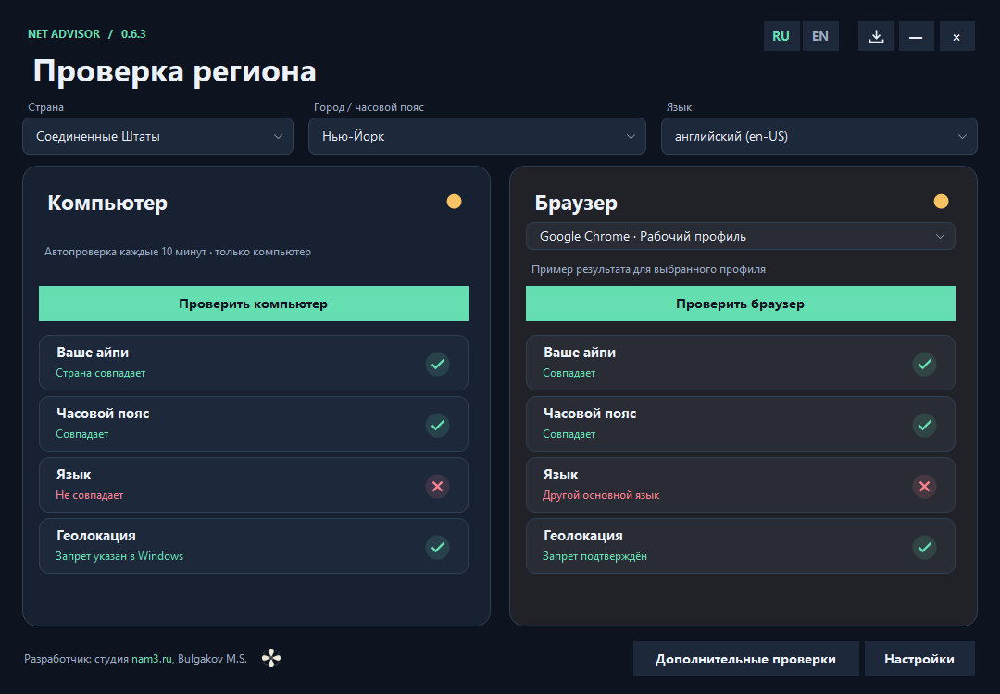
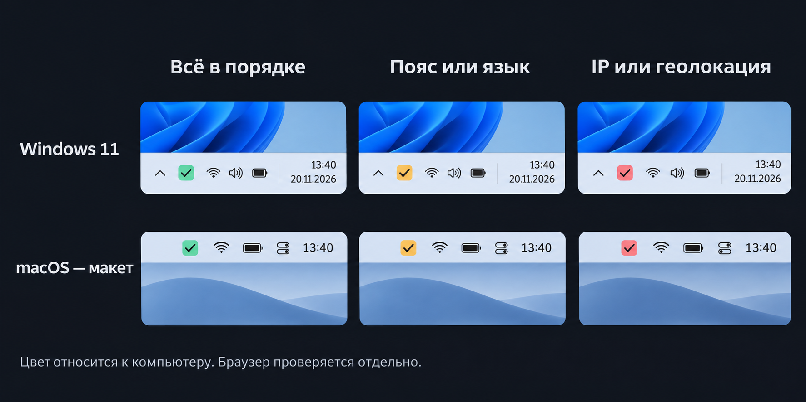
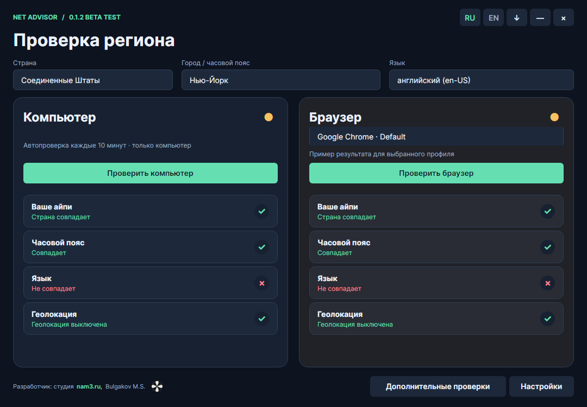

# Net Advisor

**Проверка параметров соединения и региональных настроек компьютера и браузера.**

Windows · macOS BETA TEST · Linux BETA TEST · RU / EN · Бесплатно

[**Скачать для Windows**](https://github.com/tehloft1-glitch/NetAdvisor/releases/latest) · [Все выпуски](https://github.com/tehloft1-glitch/NetAdvisor/releases) · [Студия nam3.ru](https://nam3.ru)

| Система | Версия | Скачать |
|---|---|---|
| Windows | 0.6.3 · стабильная | [Скачать](https://github.com/tehloft1-glitch/NetAdvisor/releases/download/v0.6.3/NetAdvisor-0.6.3.exe) |
| macOS · Apple Silicon | **0.1.2 BETA TEST** | [Скачать](https://github.com/tehloft1-glitch/NetAdvisor/releases/download/v0.6.3/NetAdvisor-macOS-AppleSilicon-0.1.2-BETA-TEST.zip) |
| macOS · Intel | **0.1.2 BETA TEST** | [Скачать](https://github.com/tehloft1-glitch/NetAdvisor/releases/download/v0.6.3/NetAdvisor-macOS-Intel-0.1.2-BETA-TEST.zip) |
| Linux · x64 | **0.1.2 BETA TEST** | [Скачать](https://github.com/tehloft1-glitch/NetAdvisor/releases/download/v0.6.3/NetAdvisor-Linux-x64-0.1.2-BETA-TEST.tar.gz) |

Все файлы находятся в **Assets одного выпуска**. Версия Windows остаётся 0.6.3; у macOS и Linux собственная версия 0.1.2 BETA TEST.

*Интерфейс выпущенной Windows-версии. На снимке показан пример результатов.*

## Для чего нужен Net Advisor

Net Advisor помогает проверить, соответствуют ли параметры вашего подключения выбранному региональному профилю: стране, часовому поясу и языку.

Программа показывает внешний IP, проверяет региональные настройки и доступ к геолокации. При несовпадении объясняет причину и подсказывает, где изменить настройку.

Проверки компьютера и браузера разделены: у них могут отличаться параметры подключения, язык и разрешения.

## Что проверяет программа

| Параметр | Компьютер | Выбранный браузер |
|---|---|---|
| **Внешний IP** | Страна измеренного подключения программы | Страна подключения тестовой страницы |
| **Часовой пояс** | Настройка Windows | Часовой пояс, доступный веб-странице |
| **Язык** | Основной язык Windows | Языки браузера, запроса и форматирования |
| **Геолокация** | Доступные настройки разрешений Windows | Настройки выбранного профиля и разрешение тестовой страницы |

Нажмите на результат проверки, чтобы открыть короткое объяснение и рекомендацию.

## Фоновая проверка компьютера

После запуска компьютер проверяется автоматически, затем — каждые **10 минут**, включая работу в трее.

| Индикатор | Значение |
|---|---|
| 🟢 Зелёный | Все четыре проверки компьютера пройдены |
| 🟡 Жёлтый | Требуется внимание к часовому поясу или языку |
| 🔴 Красный | Проблема с IP или геолокацией либо их результат не удалось подтвердить |
| ⚪ Нейтральный | Проверка ещё не завершена |

Цвет значка в трее относится только к компьютеру. Кружок рядом с заголовком браузера отражает его отдельные результаты.

**Браузер проверяется по кнопке. Фоновая проверка компьютера его не запускает.**

### Значок в системной панели

*Иллюстрация размещения значка, а не снимки пользовательских рабочих столов. Пример macOS — макет размещения значка. Mac-сборка доступна для BETA TEST; запуск на настоящем Mac пока не проверен.*

## Дополнительные проверки

- **DNS компьютера и браузера** — определение серверов, участвующих в тестовых запросах. Запускается отдельно.
- **WebRTC** — поиск дополнительных публичных IP, которые браузер сообщил в тесте.
- **IPv6 браузера** — проверка дополнительного подключения, если удалось получить IPv6-адрес.
- **Kill Switch** — справочная рекомендация о защите при обрыве соединения. Его наличие и работу программа автоматически не проверяет.

Другой оператор DNS или страна в его описании сами по себе не означают утечку.

## Как начать

1. Откройте [последний выпуск](https://github.com/tehloft1-glitch/NetAdvisor/releases/latest).
2. В разделе **Assets** выберите файл для своей системы из таблицы выше.
3. Windows: запустите EXE. macOS: распакуйте ZIP и откройте NetAdvisor.app. Linux: распакуйте весь архив и запустите run.sh. Регистрация не требуется.
4. Выберите страну, город / часовой пояс и ожидаемый язык.
5. Посмотрите результаты компьютера.
6. Для отдельной проверки браузера выберите браузер и профиль, затем нажмите **«Проверить браузер»**.

Для проверки браузера открывается временное тестовое окно. Результат возвращается в приложение; в поддерживаемых браузерах тестовое окно закрывается автоматически.

Справа сверху доступны переключение **RU / EN**, сворачивание в трей и обычное сворачивание окна. Щелчок по значку в трее возвращает окно, правый щелчок открывает меню.

## Поддерживаемые системы

| Система | Версия | Скачать |
|---|---|---|
| Windows | 0.6.3 · стабильная | [Скачать](https://github.com/tehloft1-glitch/NetAdvisor/releases/download/v0.6.3/NetAdvisor-0.6.3.exe) |
| macOS · Apple Silicon | **0.1.2 BETA TEST** | [Скачать](https://github.com/tehloft1-glitch/NetAdvisor/releases/download/v0.6.3/NetAdvisor-macOS-AppleSilicon-0.1.2-BETA-TEST.zip) |
| macOS · Intel | **0.1.2 BETA TEST** | [Скачать](https://github.com/tehloft1-glitch/NetAdvisor/releases/download/v0.6.3/NetAdvisor-macOS-Intel-0.1.2-BETA-TEST.zip) |
| Linux · x64 | **0.1.2 BETA TEST** | [Скачать](https://github.com/tehloft1-glitch/NetAdvisor/releases/download/v0.6.3/NetAdvisor-Linux-x64-0.1.2-BETA-TEST.tar.gz) |

### macOS — 0.1.2 BETA TEST

Для macOS 15 и новее. **Apple Silicon** — компьютеры с чипами M1, M2, M3 и новее; **Intel** — компьютеры с процессором Intel.

Распакуйте ZIP и откройте **NetAdvisor.app**. Сборки включают .NET — устанавливать его отдельно не нужно.

Это предварительный перенос. Сборки проверены на структуру пакета и архитектуру исполняемых файлов, но **не запускались на настоящем Mac**. Они пока не подписаны Apple Developer ID и не прошли нотариализацию; macOS может запросить отдельное подтверждение запуска.

### Linux — 0.1.2 BETA TEST

Linux x64 с графическим окружением X11 или XWayland. Распакуйте **весь** архив и запустите **run.sh** или **NetAdvisor**, сохранив библиотеки рядом с программой. Устанавливать .NET отдельно не нужно.

Проверены запуск окна, реальные проверки компьютера и 54 проверки логики/локального протокола в **Ubuntu 26.04 под WSLg**. Работа в других дистрибутивах и окружениях требует пользовательского тестирования.

Геолокация автоматически считывается через настройку GNOME. В других окружениях может отображаться «Настройка не определена». Работа трея зависит от поддержки StatusNotifier/AppIndicator; если доступного трея нет, сворачивание сохраняет окно в панели задач.

*Снимок запущенной Linux-сборки в Ubuntu/WSLg; показаны демонстрационные результаты.*

### Известные особенности BETA TEST

- Некоторые временные окна браузерной проверки нужно закрывать вручную после получения результата.
- Общий запрет геолокации Safari пока не подтверждается автоматически.
- Браузеры из Flatpak/Snap и нестандартные профили могут требовать ручного выбора; чтение разрешений бывает недоступно.
- Непрочитанные настройки не получают зелёную галочку.

Если что-то не работает, создайте [Issue](https://github.com/tehloft1-glitch/NetAdvisor/issues) и укажите ОС, архитектуру, версию программы и шаги воспроизведения. Не публикуйте токены, IP и личные данные профилей.

## Конфиденциальность и принцип работы

Настройки системы и разрешения браузерного профиля обрабатываются локально. Пароли, переписка и история посещений для диагностики не используются. Точные координаты программа не запрашивает.

Для измерений Net Advisor обращается к внешним сервисам определения IP, страны и сетевых параметров. Эти сервисы видят IP соединения и соответствующие тестовые запросы. DNS-тест выполняется только при отдельном запуске.

Программа не меняет системные настройки автоматически. Кнопки рекомендаций открывают нужные разделы Windows или браузера.

## Как понимать результаты

Net Advisor диагностирует измеренные параметры соединения. Он не управляет маршрутизацией, не анализирует весь трафик компьютера и не подтверждает настройки каждого установленного приложения.

Успешные проверки показывают соответствие проверенных параметров выбранному профилю. Они не гарантируют анонимность или определённое содержимое сайтов и социальных сетей.

## Поддержка

Если проверка завершилась ошибкой, создайте [обращение](https://github.com/tehloft1-glitch/NetAdvisor/issues). Укажите версию программы и Windows, название проверки, показанное сообщение и браузер, если вопрос относится к нему.

Перед публикацией скриншота скройте IP-адрес и другие личные сведения.

---

**Бесплатно для скачивания и использования.**

Разработчик: студия [nam3.ru](https://nam3.ru), Bulgakov M.S.
